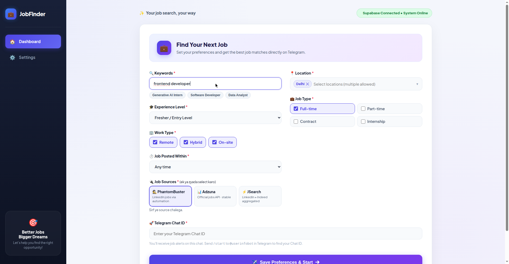
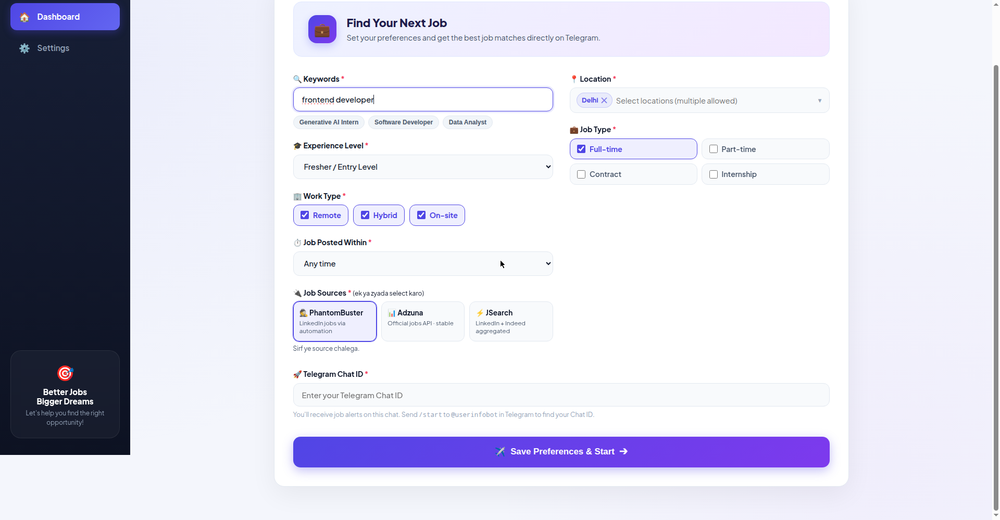

# 🔍 JobFinder Automation

> Multi-user job scraping dashboard — set your preferences once, get personalized fresher job alerts on Telegram 24x7.

**🚀 Live Demo:** https://jobfinder-automation.onrender.com

---

## 📸 Preview

| Dashboard — Preferences | Dashboard — Job History |
|---|---|
|  |  |

> Screenshots from the live deployment.

---

## ✨ Features

- **🎯 Preference-based search** — keywords, locations (multi-select, 15 Indian cities), experience level, job type, work type, posting time
- **🔌 3 job sources** — pick any combination:
  - **PhantomBuster** — LinkedIn jobs scraper (geoId-precise location filtering)
  - **Adzuna** — jobs API
  - **JSearch** — RapidAPI jobs
- **📍 Accurate location filtering** — LinkedIn searches use verified `geoId`s (not free text), so "Delhi" means Delhi — not all-India
- **🤖 n8n workflow integration** — scraped jobs are deduplicated, filtered and formatted before delivery
- **💬 Telegram alerts** — instant job notifications + a designed "No Result Found" message when a search returns 0 jobs
- **👥 Multi-user** — per-user preferences, per-user Telegram routing, per-user search history
- **⏰ Auto-scheduler** — cron-based recurring searches (default every 6 hours, configurable)
- **📊 Dashboard** — live search status, job history, CSV export, progress charts

---

## 🏗️ Architecture

```
┌─────────────┐      ┌──────────────────┐      ┌─────────────┐      ┌──────────┐
│  Dashboard  │─────▶│  Node.js Backend │─────▶│ PhantomBuster│─────▶│ LinkedIn │
│  (src/)     │      │  (server/)       │      │  Adzuna      │      │  Jobs    │
└─────────────┘      │                  │      │  JSearch     │      └──────────┘
                     │                  │      └─────────────┘
                     │                  │             │ scraped jobs
                     │                  │             ▼
                     │                  │      ┌─────────────┐      ┌──────────┐
                     │                  │─────▶│  n8n webhook │─────▶│ Telegram │
                     └──────────────────┘      │  (dedupe +  │      │  alerts  │
                                               │   filter)   │      └──────────┘
                                               └─────────────┘
```

**Flow:**
1. User sets preferences on the dashboard (keywords, location, filters, sources)
2. Backend builds source-specific search queries (LinkedIn search URL with `geoId`, API params for Adzuna/JSearch)
3. PhantomBuster agent scrapes LinkedIn → results polled → enriched with user routing metadata
4. All results POSTed to the n8n webhook → deduped against Supabase → formatted
5. Telegram message sent to the user's chat (or "No Result Found" if 0 jobs)
6. Optional: scheduler re-runs searches on a cron (default `0 */6 * * *`)

**Database:** Supabase (Postgres) — `user_preferences`, `job_searches`, `jobs_sent`

---

## 🛠️ Tech Stack

| Layer | Tech |
|---|---|
| Backend | Node.js, Express |
| Frontend | Vanilla JS + HTML/CSS (served by backend) |
| Database | Supabase (Postgres) |
| Scraping | PhantomBuster (LinkedIn), Adzuna API, JSearch API |
| Automation | n8n (webhook workflow: dedupe → filter → format) |
| Alerts | Telegram Bot API |
| Hosting | Render (backend + dashboard) |

---

## 🚀 Getting Started

### Prerequisites

- Node.js 18+
- A Supabase project (free tier works)
- PhantomBuster account + LinkedIn Jobs Scraper agent _(optional — only for LinkedIn source)_
- Adzuna API credentials _(optional — only for Adzuna source)_
- RapidAPI JSearch key _(optional — only for JSearch source)_
- n8n instance with a webhook workflow _(for Telegram delivery)_
- Telegram bot token + chat ID

### 1. Clone & install

```bash
git clone https://github.com/sonu0421/JobFinder-Automation.git
cd JobFinder-Automation
npm install
```

### 2. Configure environment

```bash
cp .env.example .env
```

Fill in `.env`:

| Variable | Required | Description |
|---|---|---|
| `PORT` | No (default 5000) | Server port |
| `SUPABASE_URL` | Yes | Supabase project URL |
| `SUPABASE_ANON_KEY` | Yes | Supabase anon key |
| `N8N_WEBHOOK_URL` | Yes | n8n webhook URL for job delivery |
| `PHANTOMBUSTER_API_KEY` | For LinkedIn source | PhantomBuster API key |
| `PHANTOMBUSTER_AGENT_ID` | For LinkedIn source | LinkedIn Jobs Scraper agent ID |
| `ADZUNA_APP_ID` / `ADZUNA_APP_KEY` | For Adzuna source | Adzuna credentials |
| `JSEARCH_API_KEY` | For JSearch source | RapidAPI key |
| `DEFAULT_TELEGRAM_CHAT_ID` | Yes | Fallback Telegram chat ID |
| `AUTO_SCHEDULE_CRON` | No | Cron pattern (default `0 */6 * * *`) |
| `ENABLE_SCHEDULER` | No | `true` to enable auto re-runs |

### 3. Set up the database

Run `supabase_schema.sql` in your Supabase SQL editor. Creates:

- `user_preferences` — per-user search prefs + Telegram chat ID
- `job_searches` — search runs with status + counts
- `jobs_sent` — dedup log (prevents duplicate alerts)

### 4. Run

```bash
npm start
```

Open **http://localhost:5000** 🎉

---

## 📖 Usage

1. **Open the dashboard** (live: https://jobfinder-automation.onrender.com)
2. **Set preferences:**
   - Keywords — e.g. `frontend developer`, `react`
   - Locations — multi-select (Delhi, Noida, Gurugram, Mumbai, Bengaluru…)
   - Experience — Intern / Fresher / Entry / Associate
   - Job type — Full-time / Part-time / Internship / Contract
   - Work type — On-site / Remote / Hybrid
   - Posted within — 1h / 6h / 12h / 24h / Any time
   - Sources — ☑️ PhantomBuster ☑️ Adzuna ☑️ JSearch (pick 1–3)
   - Telegram Chat ID — where alerts go
3. **Hit Search** — backend scrapes, n8n processes, Telegram delivers
4. **History tab** — track past searches, export CSV

### API

| Method | Endpoint | Description |
|---|---|---|
| `GET` | `/api/health` | Health check (+ `supabaseConfigured` flag) |
| `POST` | `/api/search` | Start a job search |
| `GET` | `/api/searches` | Search history |
| `GET` | `/api/preferences/:userId` | Get user prefs |
| `POST` | `/api/preferences` | Save user prefs |

---

## 🌐 Deployment (Render)

1. Push to GitHub → Render auto-deploys `main`
2. Set all env vars in the Render dashboard (never commit `.env`)
3. Free tier: service sleeps on inactivity — first load may take ~30s

**Live:** https://jobfinder-automation.onrender.com

---

## 📁 Project Structure

```
├── src/                    # Dashboard frontend (HTML/CSS/JS)
│   ├── index.html
│   ├── css/
│   └── js/ (app.js, api.js)
├── server/
│   ├── index.js            # Express app + scheduler init
│   ├── routes/api.js
│   ├── controllers/        # preferences, history, workflow
│   ├── services/
│   │   ├── phantombusterService.js  # LinkedIn URL builder (geoId) + scrape + poll
│   │   ├── adzunaService.js
│   │   ├── jsearchService.js
│   │   ├── jobDispatcher.js        # multi-source fan-out + dedupe
│   │   ├── n8nService.js          # webhook delivery
│   │   └── schedulerService.js    # node-cron recurring searches
│   └── models/dbStore.js   # Supabase data layer
├── supabase_schema.sql
├── docs/                   # preview screenshots
└── test/
```

---

## 👨‍💻 Author

**Sonu Kumar** — BTech CSE (2025), Frontend · AI Agent · Full-Stack Developer

- Portfolio: https://sonu0421.github.io
- LinkedIn: https://www.linkedin.com/in/sonukumar0421/
- GitHub: https://github.com/sonu0421

---

## 📄 License

MIT — see [LICENSE](LICENSE).
